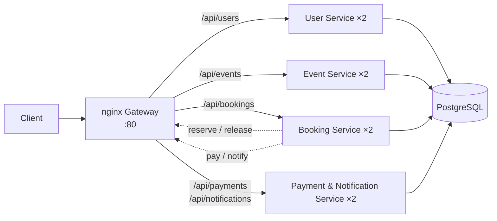
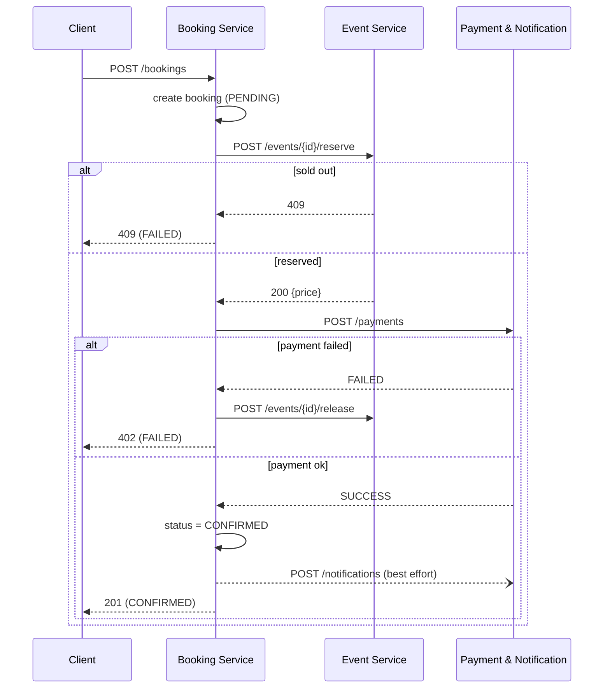

# 🎟️ Distributed Event Ticketing System

> TBZ · Modul 321 – Verteilte Systeme programmieren · LB2 Projektarbeit · AP23a

A distributed ticketing platform built from four independent microservices. Organizers publish events with a limited number of tickets, customers book and pay, and the system guarantees that **no event is ever oversold**, even with multiple replicas handling requests in parallel.

---

## Table of Contents

- [Features](#features)
- [Architecture](#architecture)
- [Booking Flow](#booking-flow)
- [Services](#services)
- [Quick Start](#quick-start)
- [Usage Example](#usage-example)
- [API Reference](#api-reference)
- [High Availability](#high-availability)
- [Testing](#testing)
- [Requirements](#requirements)
- [Project Plan](#project-plan)
- [Repository Structure](#repository-structure)
- [Team](#team)

---

## Features

- 🔐 **Authentication & roles:** JWT-based login for `customer` and `organizer`
- 📅 **Event management:** organizers create, edit and delete events with price and capacity
- 🎫 **Ticket booking:** customers book 1–10 tickets per booking
- 💳 **Mock payment:** deterministic payment simulation for reproducible tests
- 🔔 **Notifications:** confirmation message for every successful booking
- 🛡️ **No overselling:** atomic ticket reservation at database level
- ♻️ **High availability:** 2 replicas per service, load balancing, self-healing and graceful degradation

---

## Architecture



- **Gateway:** nginx routes all traffic and load-balances across replicas.
- **Service-to-service calls** also go through the gateway, so internal calls get failover too.
- **Database per service:** each service owns its own database (`users_db`, `events_db`, `bookings_db`, `payments_db`).
- **Auth:** user requests carry a JWT `{ userId, username, role }`. Internal endpoints require an `X-Service-Token` header.

---

## Booking Flow

A booking is a small **saga** with compensation on failure:



If the event or payment service is unreachable, the booking service releases any reserved tickets, marks the booking `FAILED` and returns `503`.

### Why there's no overselling

The reservation is a single atomic SQL statement in the event service:

```sql
UPDATE events SET available = available - $1
WHERE id = $2 AND available >= $1
RETURNING available, price;
```

If 0 rows come back, the event is sold out and the service returns `409`. This stays correct regardless of how many replicas are running.

---

## Services

| Service | Responsibility | Owner | Database |
|---|---|---|---|
| **User Service** | Registration, login, JWT issuing, roles | Andrin | `users_db` |
| **Event Service** | Event catalog, ticket inventory, atomic reserve/release | Andrin | `events_db` |
| **Booking Service** | Booking flow (saga), booking history | Karol | `bookings_db` |
| **Payment & Notification Service** | Mock payments, notifications | Marvin | `payments_db` |
| **Gateway** | Routing, load balancing, failover | Marvin | – |

Each service runs on port `3000` internally and exposes `GET /health`.

---

## Quick Start

**Prerequisites:** Docker and Docker Compose, running on the LernMAAS VM or locally.

```bash
git clone <repo-url>
cd ticketing-distributed
cp .env.example .env        # then set your own secrets
docker compose up -d --build
```

**`.env`**

```env
JWT_SECRET=change-me
SERVICE_TOKEN=change-me-too
DB_PASSWORD=postgres
```

Check that everything is running:

```bash
docker compose ps
curl http://localhost/api/events
```

---

## Usage Example

```bash
# 1. Register and log in as an organizer
curl -X POST http://localhost/api/users/register \
  -H "Content-Type: application/json" \
  -d '{"username":"org","password":"secret","role":"organizer"}'

ORG=$(curl -s -X POST http://localhost/api/users/login \
  -H "Content-Type: application/json" \
  -d '{"username":"org","password":"secret"}' | jq -r .token)

# 2. Create an event
curl -X POST http://localhost/api/events \
  -H "Authorization: Bearer $ORG" -H "Content-Type: application/json" \
  -d '{"title":"Concert","description":"Live","venue":"Zürich","date":"2027-03-01T20:00:00Z","price":49.9,"capacity":100}'

# 3. Register and log in as a customer
curl -X POST http://localhost/api/users/register \
  -H "Content-Type: application/json" \
  -d '{"username":"anna","password":"secret","role":"customer"}'

TOKEN=$(curl -s -X POST http://localhost/api/users/login \
  -H "Content-Type: application/json" \
  -d '{"username":"anna","password":"secret"}' | jq -r .token)

# 4. Book 2 tickets
curl -X POST http://localhost/api/bookings \
  -H "Authorization: Bearer $TOKEN" -H "Content-Type: application/json" \
  -d '{"eventId":1,"quantity":2,"paymentToken":"tok_ok"}'
```

---

## API Reference

All routes are reached through the gateway under `/api`, e.g. `http://localhost/api/events`.

**Auth legend**
- **JWT:** `Authorization: Bearer <token>`
- **Service:** `X-Service-Token: <SERVICE_TOKEN>`

### User Service

| Method | Path | Auth | Body → Response |
|---|---|---|---|
| POST | `/users/register` | – | `{username, password, role}` → `201` |
| POST | `/users/login` | – | `{username, password}` → `{token}` |
| GET | `/users/me` | JWT | → `{id, username, role}` |

### Event Service

| Method | Path | Auth | Body → Response |
|---|---|---|---|
| GET | `/events` | – | → `[event]` |
| GET | `/events/{id}` | – | → `event` / `404` |
| POST | `/events` | JWT (organizer) | `{title, description, venue, date, price, capacity}` → `201 event` |
| PUT | `/events/{id}` | JWT (owner) | same body → `200` |
| DELETE | `/events/{id}` | JWT (owner) | → `204` / `409` if tickets sold |
| POST | `/events/{id}/reserve` | Service | `{quantity}` → `200 {available, price}` / `409` |
| POST | `/events/{id}/release` | Service | `{quantity}` → `200 {available}` |

```json
{ "id": 1, "organizerId": 1, "title": "Concert", "description": "Live", "venue": "Zürich",
  "date": "2027-03-01T20:00:00Z", "price": 49.9, "capacity": 100, "available": 98 }
```

### Booking Service

| Method | Path | Auth | Body → Response |
|---|---|---|---|
| POST | `/bookings` | JWT | `{eventId, quantity, paymentToken}` → `201` / `409` / `402` / `503` |
| GET | `/bookings` | JWT | → own bookings |
| GET | `/bookings/{id}` | JWT | → `booking` / `404` |
| POST | `/bookings/{id}/cancel` | JWT | → `200 booking` *(optional)* |

```json
{ "id": 7, "userId": 2, "eventId": 1, "quantity": 2, "totalPrice": 99.8,
  "status": "CONFIRMED", "createdAt": "2026-10-05T09:12:00Z" }
```

Status values: `PENDING` · `CONFIRMED` · `FAILED` · `CANCELLED`

### Payment & Notification Service

| Method | Path | Auth | Body → Response |
|---|---|---|---|
| POST | `/payments` | Service | `{bookingId, amount, paymentToken}` → `{paymentId, status}` |
| POST | `/notifications` | Service | `{userId, message}` → `201` |
| GET | `/notifications` | JWT | → own notifications |

**Mock payment:** `paymentToken: "tok_ok"` returns `SUCCESS`, and `"tok_fail"` returns `FAILED`.

> The interface contract in [`docs/api.md`](docs/api.md) is binding. Changes need agreement from every member whose service uses the interface.

---

## High Availability

| # | Measure | Effect | Owner |
|---|---|---|---|
| 1 | **2 replicas per service** behind nginx (`max_fails`, `fail_timeout`) | One instance can fail without an outage | Marvin |
| 2 | **Healthchecks + `restart: always`** | Crashed containers restart automatically | Marvin |
| 3 | **Stateless services (JWT)** | Any replica can handle any request | Andrin |
| 4 | **Atomic reservation** | Consistent even under parallel access | Andrin |
| 5 | **Compensation (release)** | No tickets stay blocked after failures | Karol |
| 6 | **Graceful degradation** | A notification outage doesn't block bookings | Karol |
| 7 | **Safe retries** | nginx only retries a POST if the connection failed before sending, so there are no double bookings | Marvin |
| 8 | *Optional:* PostgreSQL replica, cleanup job for stuck `PENDING` bookings | Removes the DB single point of failure and handles crashed sagas | Karol |

**Live demo:**

```bash
docker stop booking-service-1     # system keeps working through replica 2
docker kill event-service-2       # container restarts automatically
```

---

## Testing

| ID | Test | Expected result |
|---|---|---|
| T1 | Register + log in | `201`, then token received |
| T2 | Customer tries to create an event | `403` |
| T3 | Call `reserve` without a service token | `401` |
| T4 | Book with `tok_ok` | `201 CONFIRMED`, `available` reduced, notification exists |
| T5 | Book with `tok_fail` | `402 FAILED`, `available` unchanged |
| T6 | Book more tickets than are available | `409` |
| T7 | Cancel a booking | `CANCELLED`, tickets released |
| T8 | **Oversell test:** capacity 10, 50 parallel single-ticket bookings | Exactly 10 × `201`, `available = 0` |
| T9 | Stop one replica of each service, then book | Booking succeeds |
| T10 | `docker kill` a container | Container restarts automatically |
| T11 | Stop both payment replicas, then book | `503`, tickets released |
| T12 | Notification path unavailable, then book | Booking still `CONFIRMED` |
| T13 | `docker compose down && up` | Data persists |

### Oversell test (T8)

Set `$TOKEN` to a customer token and `$ID` to an event with capacity 10:

```bash
seq 50 | xargs -P 50 -I{} curl -s -o /dev/null -w "%{http_code}\n" \
  -X POST http://localhost/api/bookings \
  -H "Authorization: Bearer $TOKEN" -H "Content-Type: application/json" \
  -d "{\"eventId\":$ID,\"quantity\":1,\"paymentToken\":\"tok_ok\"}" | sort | uniq -c
```

Expected output:

```
  10 201
  40 409
```

Results are recorded in [`docs/test-protocol.md`](docs/test-protocol.md).

---

## Requirements

### Functional

| ID | Requirement | Priority |
|---|---|---|
| F1 | Users can register and log in (role `customer` or `organizer`) | Must |
| F2 | Organizers can create, edit and delete events | Must |
| F3 | Everyone can list events and see available tickets | Must |
| F4 | Customers can book 1–10 tickets for an event | Must |
| F5 | A booking only succeeds if tickets are available and payment succeeds | Must |
| F6 | Customers see their bookings with status | Must |
| F7 | Customers get a notification for a confirmed booking | Must |
| F8 | Customers can cancel a booking, which releases the tickets | Optional |
| F9 | Events with sold tickets can't be deleted | Optional |
| F10 | Stuck `PENDING` bookings are cleaned up after 5 min | Optional |
| F11 | Web frontend | Optional |

### Non-functional

| ID | Requirement | Priority |
|---|---|---|
| NF1 | No overselling, even with parallel requests on multiple replicas | Must |
| NF2 | Failure of one instance per service causes no outage | Must |
| NF3 | Crashed containers restart automatically | Must |
| NF4 | Passwords are hashed (bcrypt); internal endpoints are protected by a service token | Must |
| NF5 | The whole system starts with `docker compose up` on the LernMAAS VM | Must |
| NF6 | If the notification service fails, the booking still goes through | Must |
| NF7 | API is documented with OpenAPI | Optional |
| NF8 | PostgreSQL primary/replica | Optional |

---

## Project Plan

| Phase | Lessons | Content | Milestone |
|---|---|---|---|
| 1. Kick-off & planning | L1–3 | Requirements, interfaces, owners, planning document | **M1:** Plan approved by teacher |
| 2. Setup & proof of concept | L4–5 | Repo, compose, gateway, HA kill test, atomic reserve prototype | **M2:** HA + consistency concept works |
| 3. Implementation | L6–13 | Each person builds their service against `docs/api.md` | **M3:** Interim review (~L10) |
| 4. Integration & HA | L14–16 | Full stack, booking flow end-to-end, HA tests | **M4:** System running on VM |
| 5. Testing & fixes | L17–18 | Full test protocol, bug fixes | – |
| 6. Documentation & submission | L19–20 | Component chapters, final merge, tag `v1.0` | **M5:** Submission |

**Git workflow:** feature branches per person, merged into `main` via PR with one review. The final submission state is on `main`, tagged `v1.0`.

---

## Repository Structure

```
ticketing-distributed/
├── docker-compose.yml
├── .env.example
├── gateway/
│   └── nginx.conf
├── db/
│   └── init.sql
├── user-service/
├── event-service/
├── booking-service/
├── payment-service/
├── frontend/              # optional
└── docs/
    ├── api.md             # binding interface contract
    └── test-protocol.md
```

---

## Team

| Name | Components | Additional responsibility | Documentation chapters |
|---|---|---|---|
| **Andrin** | User Service, Event Service | – | Requirements; component chapters User + Event Service |
| **Karol** | Booking Service | PostgreSQL setup (+ optional replica), merging & formatting the documentation | Procedure / project planning, conclusion; component chapter Booking Service |
| **Marvin** | Payment & Notification Service | nginx gateway, Docker Compose, web frontend *(optional)* | System overview (architecture + HA concept); component chapter Payment & Notification Service |

---

<sub>Built for TBZ Modul 321 · No existing software used · All components developed from scratch</sub>
