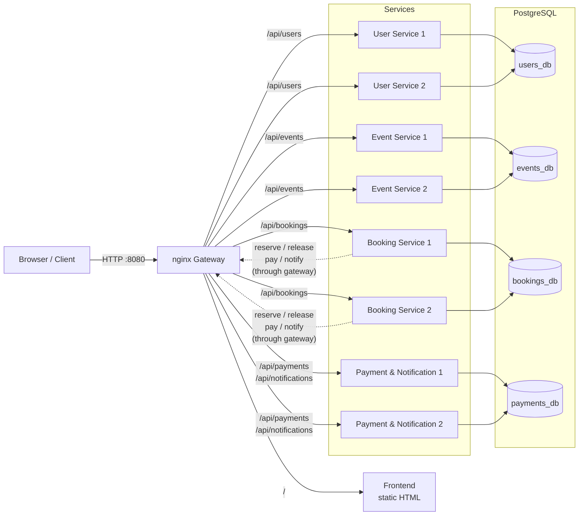
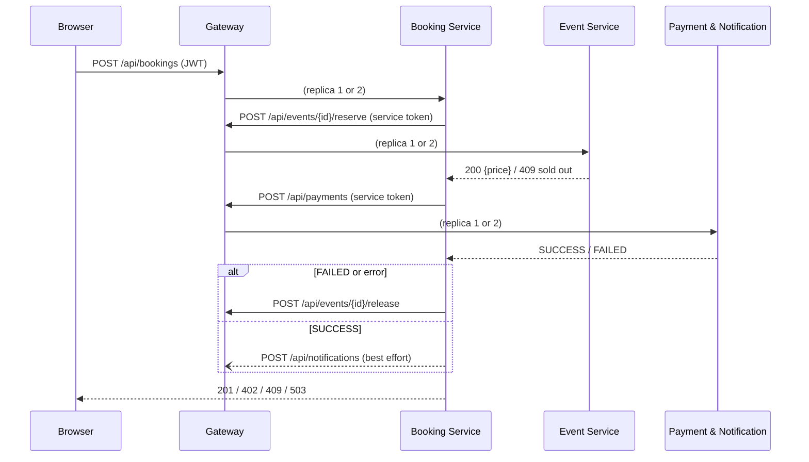
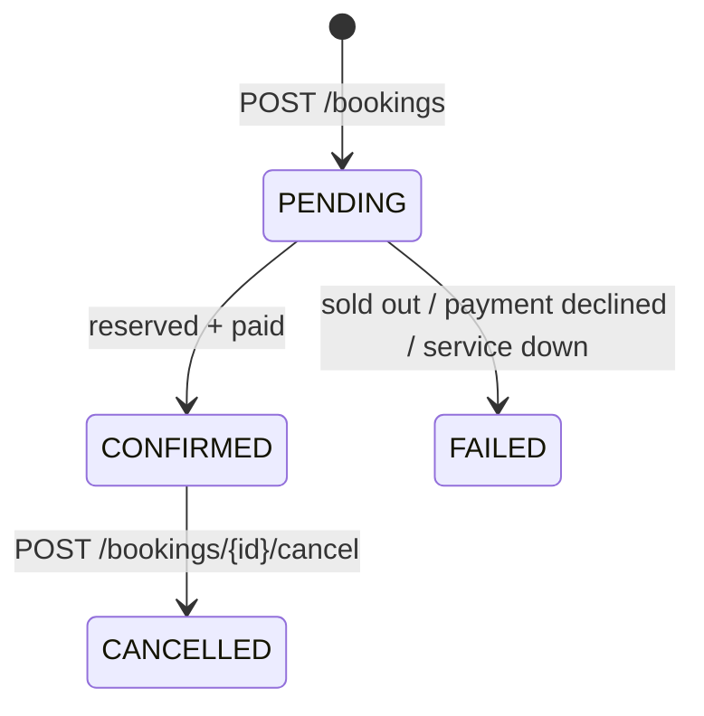
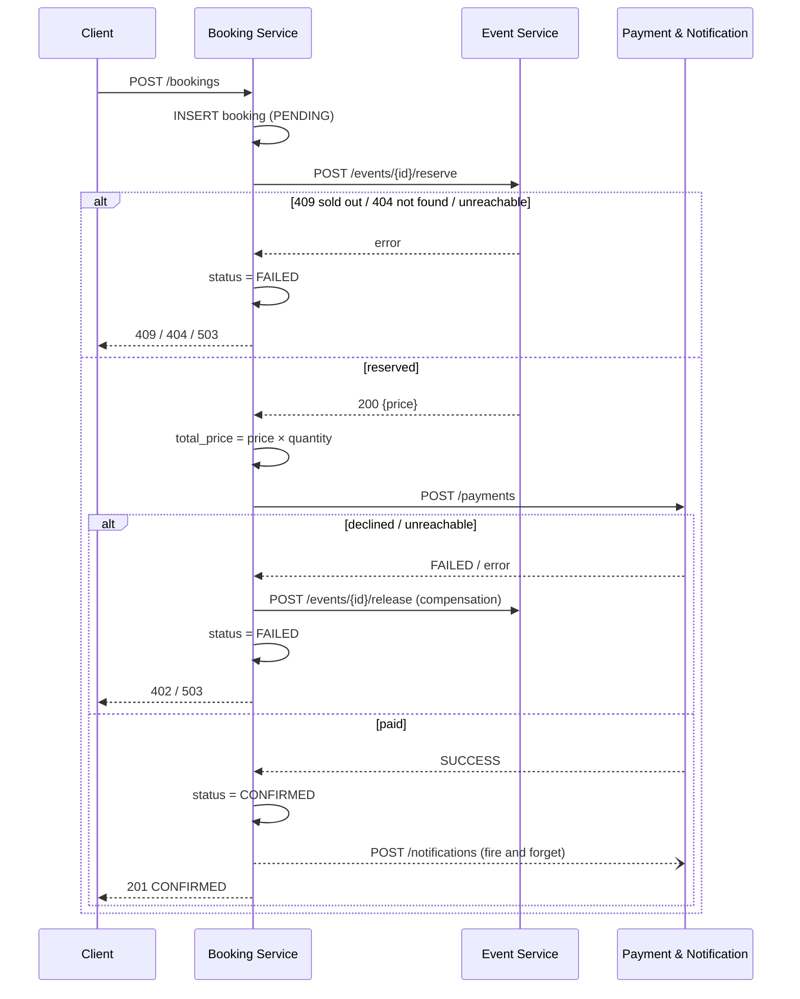

## 1 Procedure (project planning)

<p class="byline">Author: Karol</p>

### 1.1 Team and responsibilities

| Member | Component(s) | Additional responsibility |
|---|---|---|
| Andrin | User Service, Event Service | Requirements chapter |
| Karol | Booking Service | PostgreSQL setup, web frontend, merging and formatting the documentation |
| Marvin | Payment & Notification Service | nginx gateway, Docker Compose, system overview (architecture + HA concept) |

Each member implements, integrates and documents their own component. The split gives every member one service with real logic and one cross-cutting task.

### 1.2 Phases and milestones

The project followed the procedure suggested in the LB2 assignment. Planned and actual dates:

| Phase | Lessons | Content | Milestone | Reached |
|---|---|---|---|---|
| 1. Kick-off & planning | L1–3 | Requirements, interfaces, owners, README as planning document | **M1:** plan approved by the teacher | 21.09.2026 – plan (README) approved by the teacher |
| 2. Setup & proof of concept | L4–5 | Repository, Compose, gateway, atomic reserve prototype | **M2:** HA + consistency concept works | 28.09.2026 – Booking Service skeleton with saga and `db/init.sql`, tested against a mock gateway incl. 50 parallel bookings |
| 3. Implementation | L6–13 | Each member builds their service against the interface contract | **M3:** interim review with the teacher | 19.10.2026 – status meeting with the teacher, all services merged into `main` the same day |
| 4. Integration & HA | L14–16 | Full stack, booking flow end to end, HA tests | **M4:** system running on the VM | 19.10.2026 all services merged into `main` · 26.10.2026 running on the LernMAAS VM |
| 5. Testing & fixes | L17–18 | Test protocol, bug fixes | – | 25.10.2026 frontend fixes, gateway healthcheck fix |
| 6. Documentation & submission | L19–20 | Component chapters, final merge, tag `v1.0` | **M5:** submission | 27.10.2026 |

### 1.3 Working method

- **Interface first.** Before writing code, all endpoints, request/response bodies, status codes and the auth scheme (JWT for users, `X-Service-Token` for service-to-service calls) were fixed in the README. This allowed each member to develop independently: the Booking Service was built and tested against a small **mock gateway** (`booking-service/dev/mock-gateway.js`) before the Event and Payment services existed.
- **Git workflow.** One shared repository on GitHub. Each member works on a feature branch (`karol/booking-service`, `feature/andrin-user-event-service`, `marvin/payment-notification-gateway`, `karol/frontend`) and merges into `main` through a pull request. `main` always contains a working state; the final submission state is `main`, tagged `v1.0`.
- **Same technology stack.** All services use Node.js 20, Express and PostgreSQL. This was not required, but it let us share patterns (startup DB retry, `/health`, service-token check) and help each other.
- **Testing along the way.** Each component was tested on its own (mock gateway for the Booking Service, `scripts/test-user-event.sh` for User/Event Service) and then end to end through the gateway (test table T1–T13).

### 1.4 Deviations from the plan

- The **web frontend (F11)** was planned as optional for Marvin. Karol implemented it after the integration, because it makes the system much easier to demonstrate.
- On the LernMAAS VM, **port 80 is used by the VM's own web UI (Apache)**. The gateway therefore runs on port **8080** (`HTTP_PORT=8080` in `.env`); no code change was needed.
- Optional items not implemented: F10 (cleanup of stuck `PENDING` bookings), NF7 (OpenAPI), NF8 (PostgreSQL replica). See the conclusion.

## 2 Requirements and features

<p class="byline">Author: Andrin</p>

### 2.1 Starting point

Event organizers want to sell a limited number of tickets online. Several customers may try to buy the last tickets at the same moment, and the system runs as multiple replicas. The core problem is therefore **consistency under concurrency**: an event must never be oversold, and a failure of a single instance must not take the system down.

### 2.2 Roles

| Role | Can do |
|---|---|
| Visitor (no login) | List events, see details and available tickets |
| `customer` | Book and cancel tickets, see own bookings and notifications |
| `organizer` | Create, edit and delete own events |

### 2.3 Functional requirements

| ID | Requirement | Priority | Implemented in |
|---|---|---|---|
| F1 | Users can register and log in (role `customer` or `organizer`) | Must | User Service |
| F2 | Organizers can create, edit and delete events | Must | Event Service |
| F3 | Everyone can list events and see available tickets | Must | Event Service |
| F4 | Customers can book 1–10 tickets for an event | Must | Booking Service (limit also enforced in Event Service) |
| F5 | A booking only succeeds if tickets are available and payment succeeds | Must | Booking + Event + Payment |
| F6 | Customers see their bookings with status | Must | Booking Service |
| F7 | Customers get a notification for a confirmed booking | Must | Payment & Notification |
| F8 | Customers can cancel a booking, which releases the tickets | Optional | Booking + Event (`release`) |
| F9 | Events with sold tickets can't be deleted | Optional | Event Service |
| F10 | Stuck `PENDING` bookings are cleaned up after 5 min | Optional | Booking Service |
| F11 | Web frontend | Optional | Frontend |

### 2.4 Non-functional requirements

| ID | Requirement | Priority | How it is verified |
|---|---|---|---|
| NF1 | No overselling, even with parallel requests on multiple replicas | Must | T8 |
| NF2 | Failure of one instance per service causes no outage | Must | T9 |
| NF3 | Crashed containers restart automatically | Must | T10 |
| NF4 | Passwords hashed (bcrypt); internal endpoints protected by a service token | Must | T3, code review |
| NF5 | Whole system starts with `docker compose up` on the LernMAAS VM | Must | M4 |
| NF6 | If the notification service fails, the booking still goes through | Must | T12 |
| NF7 | API documented with OpenAPI | Optional | – |
| NF8 | PostgreSQL primary/replica | Optional | – |

### 2.5 Constraints

- All components are developed from scratch (no existing ticketing software).
- Runs on Docker / Docker Compose on the LernMAAS VM.
- Interfaces between services are fixed in the API reference of the README; changes need agreement from every affected owner.

## 3 System overview

<p class="byline">Author: Marvin</p>

### 3.1 Components

The system consists of four independently developed services, a gateway, a database and a web frontend. Every service runs **twice** (two replicas); all traffic goes through the gateway.

| Component | Responsibility | Owner | Database | Replicas |
|---|---|---|---|---|
| nginx gateway | Single entry point, routing, load balancing, failover, serves the frontend | Marvin | – | 1 |
| User Service | Registration, login, JWT issuing, roles | Andrin | `users_db` | 2 |
| Event Service | Event catalog, ticket inventory, atomic reserve/release | Andrin | `events_db` | 2 |
| Booking Service | Booking flow (saga), booking history, cancelling | Karol | `bookings_db` | 2 |
| Payment & Notification Service | Mock payments, notifications | Marvin | `payments_db` | 2 |
| PostgreSQL 16 | One container with one database per service | Karol | – | 1 |
| Web frontend | Single-page app for customers and organizers | Karol | – | served by gateway |

### 3.2 Architecture



**Key points:**

- **One entry point.** Clients only know the gateway (`http://<host>:8080`). The gateway maps `/api/<service>/…` to the right service and serves the frontend at `/`.
- **Service-to-service calls also go through the gateway.** The Booking Service calls `http://gateway/api/events/{id}/reserve` etc. instead of a fixed container. This way internal calls get the same load balancing and failover as client calls.
- **Database per service.** Each service owns its database and creates its own tables. No service reads another service's tables; data from other services is only accessed through their API.
- **Two kinds of authentication.**
  - *Users:* the User Service issues a JWT `{ userId, username, role }`. All services verify it themselves with the shared `JWT_SECRET`, so no service has to ask the User Service at request time.
  - *Services:* internal endpoints (`reserve`, `release`, `payments`, `POST notifications`) require the header `X-Service-Token` with the shared `SERVICE_TOKEN`. Customers can't call them directly.

### 3.3 Interaction: a booking

The most important flow is a booking, which involves all services:



Details of the booking saga are in the Booking Service chapter, details of the atomic reservation in the Event Service chapter.

### 3.4 High-availability concept

The goal: the failure of **any single service instance** must not stop the system, the system must **heal itself**, and the data must stay **consistent** under parallel load.

| # | Measure | Where | Effect | Test |
|---|---|---|---|---|
| 1 | **2 replicas per service** behind nginx, with `max_fails=1 fail_timeout=10s` | Compose, gateway | One instance can fail without an outage; nginx stops sending traffic to it for 10 s | T9 |
| 2 | **Healthchecks + `restart: always`** | Compose, all services | Crashed containers restart automatically; Docker shows whether a service can reach its DB | T10 |
| 3 | **Stateless services (JWT)** | All services | Any replica can handle any request; no session stickiness needed | T9 |
| 4 | **Atomic reservation** | Event Service | No overselling, regardless of how many replicas run | T8 |
| 5 | **Compensation (release)** | Booking Service | Failed bookings give their tickets back | T5, T11 |
| 6 | **Graceful degradation** | Booking Service | If notifications fail, the booking still succeeds | T12 |
| 7 | **Safe retries** | Gateway | nginx fails over to the other replica, but never repeats a POST that already reached a service, so there are no double bookings or double payments | T9 |
| 8 | **Persistent volume** | Compose, PostgreSQL | Data survives restarts and `docker compose down` / `up` | T13 |

Measures 1, 2, 3 and 7 handle **availability** (the system keeps answering), measures 4, 5 and 6 handle **consistency** (the answers stay correct even when parts fail).

**Remaining single point of failure:** PostgreSQL runs as one container. `restart: always` and the healthcheck shorten an outage, but while the database is down no service can work. A primary/replica setup was planned as optional (NF8) and not implemented.

### 3.5 Deployment

The whole system is started with one command on the LernMAAS VM:

```bash
cp .env.example .env      # set JWT_SECRET, SERVICE_TOKEN, DB_PASSWORD, HTTP_PORT
docker compose up -d --build
```

On the VM the gateway listens on port **8080**, because port 80 is used by the VM's own web UI. The application is reachable at `http://10.4.31.20:8080` from inside the LernMAAS VPN.

## 4 Components

Each component is documented by the team member responsible for it.

### 4.1 User Service

<p class="byline">Author: Andrin</p>

#### 4.1.1 Responsibility

Registration, login and issuing JWTs. It is the only service that knows passwords. All other services only verify the JWT signature with the shared `JWT_SECRET`, so they never have to call the User Service at request time.

#### 4.1.2 Technology

Node.js 20, Express, `pg`, `bcryptjs`, `jsonwebtoken`. Port `3000`, own database `users_db`.

#### 4.1.3 Data model

```sql
CREATE TABLE users (
  id            SERIAL PRIMARY KEY,
  username      VARCHAR(32)  NOT NULL UNIQUE,
  password_hash VARCHAR(100) NOT NULL,
  role          VARCHAR(16)  NOT NULL CHECK (role IN ('customer','organizer')),
  created_at    TIMESTAMPTZ  NOT NULL DEFAULT now()
);
```

The table is created by the service on startup (`CREATE TABLE IF NOT EXISTS`), so it does not depend on `db/init.sql` beyond the database itself existing.

#### 4.1.4 Endpoints

| Method | Path | Auth | Response |
|---|---|---|---|
| POST | `/users/register` | – | `201 {id, username, role}` · `400` invalid · `409` username taken |
| POST | `/users/login` | – | `200 {token}` · `401` wrong credentials |
| GET | `/users/me` | JWT | `200 {id, username, role}` · `401` |
| GET | `/health` | – | `200` · `503` if DB unreachable |

#### 4.1.5 Design decisions

- **Password hashing:** bcrypt with cost 10. The same `401` is returned for an unknown user and a wrong password, so usernames can't be probed.
- **JWT:** HS256, payload `{ userId, username, role }`, valid 8 h. Because the token is self-contained, the services are **stateless** (HA measure 3): any replica can handle any request.
- **Race-free registration:** `INSERT … ON CONFLICT (username) DO NOTHING` together with the `UNIQUE` constraint, so two replicas registering the same name at once can't both succeed.
- **Validation:** username 3–32 chars `[a-zA-Z0-9_.-]`, password 4–72 chars (bcrypt only uses 72 bytes), role must be `customer` or `organizer`.

#### 4.1.6 Configuration

| Variable | Default | Meaning |
|---|---|---|
| `JWT_SECRET` | – (required) | Signing key, identical in all services |
| `JWT_EXPIRES_IN` | `8h` | Token lifetime |
| `DB_HOST` / `DB_PORT` | `postgres` / `5432` | Database |
| `DB_USER` / `DB_PASSWORD` / `DB_NAME` | `postgres` / `postgres` / `users_db` | Credentials |
| `PORT` | `3000` | HTTP port |

### 4.2 Event Service

<p class="byline">Author: Andrin</p>

#### 4.2.1 Responsibility

Event catalog and ticket inventory. It owns the number of available tickets per event and is the only place where that number changes, through the internal `reserve` and `release` endpoints called by the Booking Service.

#### 4.2.2 Technology

Node.js 20, Express, `pg`, `jsonwebtoken`. Port `3000`, own database `events_db`.

#### 4.2.3 Data model

```sql
CREATE TABLE events (
  id           SERIAL PRIMARY KEY,
  organizer_id INTEGER       NOT NULL,
  title        VARCHAR(200)  NOT NULL,
  description  TEXT          NOT NULL DEFAULT '',
  venue        VARCHAR(200)  NOT NULL,
  date         TIMESTAMPTZ   NOT NULL,
  price        NUMERIC(10,2) NOT NULL CHECK (price >= 0),
  capacity     INTEGER       NOT NULL CHECK (capacity > 0),
  available    INTEGER       NOT NULL,
  created_at   TIMESTAMPTZ   NOT NULL DEFAULT now(),
  CONSTRAINT available_in_range CHECK (available >= 0 AND available <= capacity)
);
```

`organizer_id` is the `userId` from the JWT. There is no foreign key to `users`, because each service owns its own database.

#### 4.2.4 Endpoints

| Method | Path | Auth | Response |
|---|---|---|---|
| GET | `/events` | – | `200 [event]` |
| GET | `/events/{id}` | – | `200 event` · `404` |
| POST | `/events` | JWT organizer | `201 event` · `400` · `401` · `403` |
| PUT | `/events/{id}` | JWT owner | `200 event` · `403` not owner · `404` · `409` capacity below sold |
| DELETE | `/events/{id}` | JWT owner | `204` · `403` · `404` · `409` tickets sold |
| POST | `/events/{id}/reserve` | Service token | `200 {available, price}` · `400` · `401` · `404` · `409` sold out |
| POST | `/events/{id}/release` | Service token | `200 {available}` · `400` · `401` · `404` |
| GET | `/health` | – | `200` · `503` |

#### 4.2.5 Consistency: why there is no overselling

The reservation is one atomic SQL statement:

```sql
UPDATE events SET available = available - $1
WHERE id = $2 AND available >= $1
RETURNING available, price;
```

PostgreSQL takes a row lock for the `UPDATE`. A second, parallel transaction on the same row waits, then re-evaluates the `WHERE` condition on the new value. If too few tickets are left, 0 rows are updated and the service answers `409`. Because the check and the decrement happen in the same statement inside the database, it doesn't matter how many replicas of the Event Service are running. In addition, the `CHECK (available >= 0)` constraint acts as a last safety net.

A read-then-write approach (`SELECT available` → check in JavaScript → `UPDATE`) would be wrong: two replicas could both read `available = 1` and both sell the last ticket.

#### 4.2.6 Other design decisions

- **Release is capped:** `available = LEAST(capacity, available + $1)`. A duplicated compensation call (e.g. retry after a timeout) can never create more tickets than the capacity.
- **Editing capacity:** sold tickets (`capacity − available`) stay sold. The new capacity must be at least the sold count (otherwise `409`), and `available` is recalculated in a transaction with `SELECT … FOR UPDATE`, so a parallel reservation can't get lost.
- **Deleting (F9):** `DELETE … WHERE id = $1 AND organizer_id = $2 AND available = capacity` is atomic, so an event can't be deleted at the same moment a ticket is sold.
- **Service token:** compared with `crypto.timingSafeEqual`. Customers can't call `reserve`/`release` directly (test T3).
- **Quantity 1–10** is validated here as well, not only in the Booking Service.
- **Startup:** the service retries the DB connection for up to 60 s, so it doesn't crash if PostgreSQL starts later. `/health` returns `503` when the DB is unreachable, so the Docker healthcheck reflects the real state.
- **Gateway prefix:** routes work both with and without `/api`, so it doesn't matter whether nginx strips the prefix.

#### 4.2.7 Configuration

Same variables as the User Service, plus `SERVICE_TOKEN` (required, identical in all services). Default `DB_NAME` is `events_db`.

### 4.3 Booking Service

<p class="byline">Author: Karol</p>

#### 4.3.1 Responsibility

The Booking Service runs the **booking flow**. It is the only component that talks to all others: it reserves tickets in the Event Service, charges the customer through the Payment Service, confirms the booking and triggers a notification. It also stores every booking with its status, so customers can see their booking history, and lets customers cancel a confirmed booking.

It owns no tickets and no money itself. It coordinates the other services and makes sure that, whatever fails, the system ends up in a consistent state.

#### 4.3.2 Technology

Node.js 20, Express, `pg`, `jsonwebtoken`. No HTTP client library: service calls use Node's built-in `fetch` with `AbortSignal.timeout`. Port `3000`, own database `bookings_db`.

| File | Content |
|---|---|
| `src/index.js` | Express app, `/health`, error handler, startup and graceful shutdown |
| `src/config.js` | Reads and validates environment variables |
| `src/db.js` | Connection pool, DB retry on startup, table migration |
| `src/auth.js` | JWT check (`requireJwt`) and role check (`requireRole`) |
| `src/clients.js` | Calls to Event, Payment and Notification through the gateway |
| `src/bookings.js` | All `/bookings` routes including the saga |
| `dev/mock-gateway.js` | Stand-in for the other services during development |

#### 4.3.3 Data model

```sql
CREATE TABLE bookings (
  id          SERIAL PRIMARY KEY,
  user_id     INTEGER NOT NULL,
  event_id    INTEGER NOT NULL,
  quantity    INTEGER NOT NULL CHECK (quantity BETWEEN 1 AND 10),
  total_price NUMERIC(10, 2),
  status      TEXT NOT NULL DEFAULT 'PENDING'
              CHECK (status IN ('PENDING', 'CONFIRMED', 'FAILED', 'CANCELLED')),
  created_at  TIMESTAMPTZ NOT NULL DEFAULT now(),
  updated_at  TIMESTAMPTZ NOT NULL DEFAULT now()
);
CREATE INDEX bookings_user_id_idx        ON bookings (user_id);
CREATE INDEX bookings_status_created_idx ON bookings (status, created_at);
```

`user_id` comes from the JWT and `event_id` from the request; there are no foreign keys because users and events live in other services' databases. `total_price` is `NULL` until the Event Service has returned the price. The index on `(status, created_at)` is prepared for the optional cleanup job of stuck `PENDING` bookings (F10).

Status values:



#### 4.3.4 Endpoints

All endpoints require a customer JWT (`Authorization: Bearer …`).

| Method | Path | Body | Response |
|---|---|---|---|
| POST | `/bookings` | `{eventId, quantity, paymentToken}` | `201 booking` · `400` invalid · `401` · `403` not a customer · `402` payment declined · `404` event not found · `409` not enough tickets · `503` a service unavailable |
| GET | `/bookings` | – | `200 [booking]`, own bookings, newest first |
| GET | `/bookings/{id}` | – | `200 booking` · `404` (also for other users' bookings) |
| POST | `/bookings/{id}/cancel` | – | `200 booking` · `404` · `409` not `CONFIRMED` · `503` Event Service unavailable |
| GET | `/health` | – | `200 {status: "ok"}` · `503` if DB unreachable |

```json
{ "id": 7, "userId": 2, "eventId": 1, "quantity": 2, "totalPrice": 99.8,
  "status": "CONFIRMED", "createdAt": "2026-10-19T09:01:32.081Z" }
```

On failure the response contains the error and the failed booking, e.g. `402 { "error": "Payment failed", "booking": { …, "status": "FAILED" } }`.

#### 4.3.5 The booking saga

A booking spans three services with three separate databases, so a single database transaction is not possible. The Booking Service therefore implements a **saga**: a sequence of local steps, where each step that has already succeeded is undone by a **compensation** step if a later step fails.



Key rules in the implementation (`src/bookings.js`):

1. **The booking is written first** (`PENDING`), before any other service is called. Every attempt is therefore traceable, even if the service crashes in the middle.
2. **The reservation is the critical step.** The Event Service decrements `available` atomically (see the Event Service chapter); the Booking Service only reacts to the result. This is why there is no overselling even with two Booking and two Event replicas (test T8).
3. **Compensation.** A local flag `reserved` records whether tickets were taken. Every failure after that point, including unexpected errors such as the database failing mid-saga, calls `release` before the booking is marked `FAILED` (HA measure 5). `release` never throws: if it fails, the error is logged and the booking stays `FAILED`.
4. **Payment result vs. payment error.** `status: "FAILED"` from the Payment Service is a declined card → `402`. A `5xx`, a missing status or a network error means the payment service is broken → release the tickets and answer `503` (test T11).
5. **Notifications are best effort** (HA measure 6). The call is not awaited; errors are only logged. A booking is never rolled back because a notification failed (test T12).
6. **Prices come from the Event Service**, never from the client. `totalPrice = round(price × quantity, 2)`.

#### 4.3.6 Cancelling (F8)

```sql
UPDATE bookings SET status = 'CANCELLED', updated_at = now()
WHERE id = $1 AND user_id = $2 AND status = 'CONFIRMED'
RETURNING *;
```

The status switch is atomic and only succeeds for a `CONFIRMED` booking of this user. Two parallel cancel requests (e.g. a double click hitting both replicas) can't both release the tickets: the second one updates 0 rows and gets `409`. If `release` fails afterwards, the status is set back to `CONFIRMED` and the client gets `503`, so the customer can retry and no tickets are lost.

#### 4.3.7 Other design decisions

- **Service calls go through the gateway** (`GATEWAY_URL=http://gateway/api`), not directly to a container. nginx load-balances and fails over between the two replicas of the target service, so internal calls get the same high availability as client calls.
- **Timeouts.** Every service call is aborted after `UPSTREAM_TIMEOUT_MS` (default 5 s), so a hanging service can't block bookings forever. The request then ends with `503` and compensation.
- **Stateless.** The service keeps no session or in-memory state; everything is in the JWT and the database. Both replicas can handle any request (HA measure 3).
- **Authorization.** Only `customer` tokens can book (`403` otherwise). `GET /bookings/{id}` returns `404` instead of `403` for other users' bookings, so booking IDs can't be probed.
- **Validation.** `eventId` positive integer, `quantity` integer 1–10, `paymentToken` non-empty string, otherwise `400`. Malformed JSON → `400`.
- **Safe migrations with two replicas.** Both replicas create the table on startup. A PostgreSQL advisory lock (`pg_advisory_lock`) makes sure only one runs the `CREATE TABLE` at a time; without it, two parallel `CREATE TABLE IF NOT EXISTS` can fail with a duplicate-type error.
- **Startup and shutdown.** On startup the service waits up to 60 s for the database. On `SIGTERM` (e.g. `docker stop`) it stops accepting connections, finishes running requests and closes the pool.
- **Healthcheck.** `/health` runs `SELECT 1`; Docker marks the container unhealthy if the DB connection is gone.

#### 4.3.8 Configuration

| Variable | Default | Meaning |
|---|---|---|
| `JWT_SECRET` | – (required) | Verifies user tokens, identical in all services |
| `SERVICE_TOKEN` | – (required) | Sent as `X-Service-Token` to internal endpoints |
| `GATEWAY_URL` | `http://gateway/api` | Base URL for service-to-service calls |
| `UPSTREAM_TIMEOUT_MS` | `5000` | Timeout per service call |
| `DB_HOST` / `DB_PORT` | `postgres` / `5432` | Database |
| `DB_USER` / `DB_PASSWORD` / `DB_NAME` | `postgres` / – (required) / `bookings_db` | Credentials |
| `PORT` | `3000` | HTTP port |

The service refuses to start if a required variable is missing, instead of running with an insecure default.

#### 4.3.9 Testing the component

During development the service ran against `dev/mock-gateway.js`, which fakes the Event, Payment and Notification endpoints and can simulate outages (`POST /mock/state {"paymentDown": true}`). With it, all booking outcomes were tested before the other services existed:

| Scenario | Result |
|---|---|
| `tok_ok` → `201 CONFIRMED`, `totalPrice` 99.8, notification sent | PASS |
| `tok_fail` → `402 FAILED`, tickets released | PASS |
| Too many tickets → `409`, unknown event → `404` | PASS |
| Payment down → `503`, tickets released | PASS |
| Notifications down → booking still `201` | PASS |
| Cancel → `CANCELLED`, tickets released; cancel twice → `409` | PASS |
| No token → `401`, organizer → `403`, quantity 11 → `400` | PASS |
| 50 parallel bookings, 9 tickets left → exactly 9 × `201` | PASS |

End-to-end results on the LernMAAS VM are in the test protocol (appendix).

### 4.4 Payment & Notification Service

<p class="byline">Author: Marvin</p>

#### 4.4.1 Responsibility

The service has two jobs:

1. **Payments:** it charges the customer for a booking. In this project payments are simulated (mock payment), so that tests are deterministic and no real payment provider is needed.
2. **Notifications:** it stores a message for the customer when a booking is confirmed, and lets the customer read their own messages.

Both are called by the Booking Service with the service token; customers only read their notifications with their JWT.

#### 4.4.2 Technology

Node.js 20, Express, `pg`, `jsonwebtoken`. Port `3000`, own database `payments_db`. JSON request bodies are limited to 32 kB.

| File | Content |
|---|---|
| `src/index.js` | Express app, `/health`, error handler, startup and graceful shutdown |
| `src/config.js` | Reads and validates environment variables |
| `src/db.js` | Connection pool, waiting for the DB on startup, table migration |
| `src/auth.js` | JWT check and service-token check |
| `src/payments.js` | `POST /payments` |
| `src/notifications.js` | `POST /notifications`, `GET /notifications` |

#### 4.4.3 Data model

```sql
CREATE TABLE payments (
  id         BIGSERIAL PRIMARY KEY,
  booking_id BIGINT NOT NULL UNIQUE CHECK (booking_id > 0),
  amount     NUMERIC(12, 2) NOT NULL CHECK (amount >= 0),
  status     TEXT NOT NULL CHECK (status IN ('SUCCESS', 'FAILED')),
  created_at TIMESTAMPTZ NOT NULL DEFAULT now()
);

CREATE TABLE notifications (
  id         BIGSERIAL PRIMARY KEY,
  user_id    BIGINT NOT NULL CHECK (user_id > 0),
  message    TEXT NOT NULL CHECK (char_length(message) BETWEEN 1 AND 1000),
  created_at TIMESTAMPTZ NOT NULL DEFAULT now()
);
CREATE INDEX notifications_user_created_idx ON notifications (user_id, created_at DESC);
```

The `UNIQUE` constraint on `booking_id` guarantees that there is at most one payment per booking. The index matches the only query on notifications ("newest messages of one user").

#### 4.4.4 Endpoints

| Method | Path | Auth | Body → Response |
|---|---|---|---|
| POST | `/payments` | Service token | `{bookingId, amount, paymentToken}` → `200 {paymentId, status}` · `400` invalid · `401` |
| POST | `/notifications` | Service token | `{userId, message}` → `201 {id, userId, message, createdAt}` · `400` · `401` |
| GET | `/notifications` | JWT | → `200 [notification]`, own notifications, newest first, max. 100 |
| GET | `/health` | – | `200 {status: "ok"}` · `503` if DB unreachable |

**Mock payment:** `paymentToken: "tok_ok"` → `SUCCESS`, `"tok_fail"` → `FAILED`. Any other token is rejected with `400`.

#### 4.4.5 Design decisions

- **Idempotent payments.** A payment is stored with

  ```sql
  INSERT INTO payments (booking_id, amount, status) VALUES ($1, $2, $3)
  ON CONFLICT (booking_id) DO NOTHING
  RETURNING id, status;
  ```

  If the booking was already paid, nothing is inserted and the stored result is returned. Paying the same booking twice, for example after a retry, never creates a second payment and always gives the same answer. This makes the payment endpoint safe in a distributed system where requests can be repeated.
- **A declined payment is a result, not an error.** `tok_fail` returns `200 {status: "FAILED"}`. The Booking Service can therefore tell a declined card (→ `402` for the customer, tickets released) apart from a broken service (`5xx` or no answer → `503`, tickets released).
- **Notifications are separated by user.** `GET /notifications` takes the `userId` from the JWT, never from a parameter, so customers can only read their own messages.
- **Strict validation.** IDs must be positive integers, the amount between 0 and 9 999 999 999.99, the message 1–1000 characters (trimmed). Invalid JSON → `400`. The database `CHECK` constraints repeat these rules as a second line of defence.
- **Service token.** Only other services can create payments and notifications (`X-Service-Token`); customers get `401`.
- **Startup and shutdown.** The service waits for the database (retry every 2 s) and creates its tables on startup. On `SIGTERM` it finishes running requests and closes the connection pool.
- **Required configuration.** Without `JWT_SECRET`, `SERVICE_TOKEN` or `DB_PASSWORD` the service refuses to start instead of running with an insecure default.

#### 4.4.6 Configuration

| Variable | Default | Meaning |
|---|---|---|
| `JWT_SECRET` | – (required) | Verifies user tokens |
| `SERVICE_TOKEN` | – (required) | Expected `X-Service-Token` for internal calls |
| `DB_HOST` / `DB_PORT` | `postgres` / `5432` | Database |
| `DB_USER` / `DB_PASSWORD` / `DB_NAME` | `postgres` / – (required) / `payments_db` | Credentials |
| `PORT` | `3000` | HTTP port |

### 4.5 nginx gateway

<p class="byline">Author: Marvin</p>

#### 4.5.1 Responsibility

The gateway is the single entry point for clients and for service-to-service calls. It routes requests, balances the load between the two replicas of each service, takes failed replicas out of rotation and serves the web frontend.

#### 4.5.2 Routing

| Path | Target |
|---|---|
| `/api/users…` | `user_service` → `/users…` |
| `/api/events…` | `event_service` → `/events…` |
| `/api/bookings…` | `booking_service` → `/bookings…` |
| `/api/payments…` | `payment_service` → `/payments…` |
| `/api/notifications…` | `payment_service` → `/notifications…` |
| `/health` | answered by nginx itself (`200 ok`) |
| other `/api/…` | `404` |
| `/` | frontend (`frontend/index.html`) |

#### 4.5.3 Load balancing and failover

Each service is an `upstream` with two servers:

```nginx
upstream booking_service {
    zone booking_service 64k;
    server booking-service-1:3000 resolve max_fails=1 fail_timeout=10s;
    server booking-service-2:3000 resolve max_fails=1 fail_timeout=10s;
    keepalive 16;
}
```

- **Round robin** between both replicas.
- **`max_fails=1 fail_timeout=10s`:** after one failed attempt, a replica gets no traffic for 10 seconds, then nginx tries it again.
- **`resolve` with Docker's DNS (`resolver 127.0.0.11 valid=10s`):** if a container is restarted and gets a new IP, nginx finds it again without a reload.
- **`keepalive 16`:** connections to the services are reused, which saves time per request.
- **Timeouts:** connect 3 s, send/read 10 s, so a hanging replica is detected quickly.

#### 4.5.4 Safe retries

```nginx
proxy_next_upstream error timeout http_502 http_503 http_504;
proxy_next_upstream_tries 2;
```

If a replica can't be reached or answers `502/503/504`, nginx sends the request to the other replica. For **non-idempotent requests (POST)** nginx only does this if the request was **not yet sent** to the first replica. A booking or payment that already reached a service is therefore never processed twice, while a request to a stopped container still fails over cleanly (HA measure 7).

The headers `Authorization` and `X-Service-Token` are passed through unchanged.

### 4.6 Docker Compose

<p class="byline">Author: Marvin</p>

`docker-compose.yml` describes the whole system: PostgreSQL, 8 service containers and the gateway.

- **Explicit replicas.** Each replica is its own Compose service with a fixed `container_name` (`booking-service-1`, `booking-service-2`, …). The gateway addresses them by name, and single replicas can be stopped for the demo (`docker stop booking-service-1`).
- **`restart: always`** for every container (HA measure 2).
- **Healthchecks:** every service `wget -qO- http://localhost:3000/health` every 10 s, 3 retries; PostgreSQL `pg_isready`; the gateway `/health`.
- **Start order:** services wait until PostgreSQL is `service_healthy`; the gateway starts after the services.
- **Shared configuration** through YAML anchors (`x-service-environment`, `x-service-healthcheck`), so all services get the same settings and the file stays short.
- **Secrets** come from `.env` (`JWT_SECRET`, `SERVICE_TOKEN`, `DB_PASSWORD`). Compose refuses to start if one is missing (`${VAR:?…}`). `.env` is not committed; `.env.example` shows the format.
- **Persistence** through the named volume `postgres_data`.
- **Port:** the gateway is published on `${HTTP_PORT:-80}`; on the LernMAAS VM `HTTP_PORT=8080`.

### 4.7 PostgreSQL setup

<p class="byline">Author: Karol</p>

#### 4.7.1 Database per service

One PostgreSQL 16 container hosts four separate databases. `db/init.sql` is mounted into `/docker-entrypoint-initdb.d/` and runs once, when the data volume is created:

```sql
CREATE DATABASE users_db;
CREATE DATABASE events_db;
CREATE DATABASE bookings_db;
CREATE DATABASE payments_db;
```

Each service connects only to its own database (`DB_NAME`) and creates its own tables on startup. No service reads another service's tables; data from other services is only accessed through their API. This keeps the components independent: a service can change its schema without breaking the others.

#### 4.7.2 Persistence and health

- Data is stored in the named volume `postgres_data`, so it survives `docker compose down` / `up` and VM restarts (test T13). Only `docker compose down -v` deletes it.
- The container has a healthcheck (`pg_isready`). All services wait for `service_healthy` before they start, and additionally retry the connection themselves.
- `restart: always` restarts the database container if it crashes.

#### 4.7.3 Limitation

The database is a **single point of failure**: if the PostgreSQL container is down, no service can work. Restart policy and healthchecks shorten the outage, but don't prevent it. A primary/replica setup (NF8) was planned as optional and not implemented; see the conclusion.

### 4.8 Web frontend (F11, optional)

<p class="byline">Author: Karol</p>

A single-page web app (`frontend/index.html`, plain HTML/CSS/JavaScript, no build step and no external libraries) served by the nginx gateway at `/`. It only uses the public API through `/api`, exactly like any other client, so it adds no new interfaces.

| Page | Content |
|---|---|
| Home | Search, category filter, featured event, event cards with availability badges |
| Event | Details, ticket box with quantity, test payment cards (`tok_ok` / `tok_fail`), order summary |
| Confirmation | Ticket with order number and code after a successful booking |
| My tickets | Confirmed tickets with cancel button, order history (failed / cancelled) |
| Log in / Sign up | Registration with role selection, login |
| Organizer dashboard | Create and delete events, tickets sold and revenue per event |

Notifications appear in a bell menu in the navigation. Error codes from the API are shown as readable messages, e.g. `402` → "Your payment was declined. No tickets were booked." The page supports dark mode and phone screens.

The JWT is kept in `localStorage`. Data from the API (event titles, usernames, messages) is always inserted with `textContent`, never as HTML, so it can't inject markup or scripts.

## 5 Conclusion

### 5.1 Result

The system meets all mandatory requirements. Four independently developed services, each running twice behind an nginx gateway, together sell tickets without ever overselling: in the oversell test, 50 parallel bookings for 10 tickets result in exactly 10 confirmed bookings, also on the LernMAAS VM. Failures of single instances, of the payment service or of notifications are handled, and the system starts with one command (`docker compose up -d --build`).

Optional features implemented: cancelling bookings (F8), protection against deleting events with sold tickets (F9) and a web frontend (F11).

### 5.2 What worked well

- **Fixing the interfaces first.** Because the API was agreed in the README before coding, the four services fit together on the first integration day with only small adjustments.
- **Putting consistency into the database.** Instead of locks between services, the critical check is a single atomic SQL statement. This is simple and correct regardless of the number of replicas.
- **Mock gateway.** The Booking Service could be developed and tested completely, including outage scenarios, before the other services existed.

### 5.3 Problems and how we solved them

| Problem | Cause | Solution |
|---|---|---|
| "Create event" button did nothing | Inline `onclick="createEvent()"` resolved to the built-in `document.createEvent()` | Buttons use `addEventListener` |
| Gateway always shown as `unhealthy` | Healthcheck used `localhost`, which resolves to IPv6 in the container; nginx only listens on IPv4 | Healthcheck uses `127.0.0.1` |
| Port 80 already in use on the VM | LernMAAS VM web UI (Apache) | Gateway on port 8080 via `HTTP_PORT` |
| `docker compose` missing on the VM | Only the Docker engine was preinstalled | Installed the `docker-compose-v2` package |

### 5.4 Outlook

- **Database high availability (NF8):** PostgreSQL primary/replica with automatic failover, to remove the last single point of failure.
- **Cleanup job (F10):** periodically release tickets of bookings stuck in `PENDING`, e.g. if a Booking Service replica crashes between `reserve` and `payment`, or if a `reserve` call times out after the Event Service already reserved the tickets.
- **OpenAPI (NF7):** a machine-readable API description generated from `docs/api.md`.
- **Idempotency keys** for `POST /bookings`, so a client retry after a network error can never create a second booking.

### 5.5 Personal reflection (Karol)

**What I learned.** Before this project I mostly knew applications with one database, where a transaction solves consistency. With the Booking Service I learned that this doesn't work across several services, and that a saga with compensation steps is a practical replacement. I also learned how much easier the critical parts get when the database does the work, as with the atomic reservation, instead of trying to coordinate replicas in code. On the infrastructure side I got more confident with Docker Compose, healthchecks and running the whole system on a remote VM.

**What went well.** Defining the interfaces at the beginning paid off: I could build and test my service against a mock gateway long before the other services existed, and the integration went smoothly.

**What I would do differently.** We integrated the services quite late in the project. Next time I would connect the components earlier, even with only basic functionality, so problems show up sooner. I would also write the documentation continuously during development instead of mostly at the end, and add automated tests to the repository from the start.

**Teamwork.** The clear split into one component per person worked well, because everyone could work independently. Coordination mostly happened through the README and pull requests. Towards the end we had to coordinate more closely to bring the system and the documentation together in time.

## Appendix A: Test log

### A.1 Automated tests User + Event Service

<p class="byline">Author: Andrin</p>

`scripts/test-user-event.sh` runs 30 automated checks, including T1, T2, T3, T6 and T8 at Event Service level (50 parallel single-ticket reservations on an event with capacity 10, spread over **two replicas**):

```
             10 200
             40 409
  PASS  T8 exactly 10 reserves succeed
  PASS  T8 40 reserves rejected (409)
  PASS  T8 available = 0
...
Result: 30 passed, 0 failed
```

Run against the gateway:

```bash
SERVICE_TOKEN=<value from .env> ./scripts/test-user-event.sh
```

### A.2 End-to-end tests on the LernMAAS VM

Executed on 26.10.2026 against the complete system on the LernMAAS VM (`http://10.4.31.20:8080`), all requests through the gateway.

| ID | Test | Expected | Result |
|---|---|---|---|
| T1 | Register + log in | `201`, token received | ✅ `201` / token received |
| T2 | Customer tries to create an event | `403` | ✅ `403` |
| T3 | Call `reserve` without a service token | `401` | ✅ `401` |
| T4 | Book 2 tickets with `tok_ok` | `201 CONFIRMED`, `available` 10 → 8, notification exists | ✅ `CONFIRMED`, `available = 8`, 1 notification |
| T5 | Book with `tok_fail` | `402 FAILED`, `available` unchanged | ✅ `402`, `available = 8` |
| T6 | Book more tickets than available | `409` | ✅ `409` |
| T7 | Cancel a booking | `CANCELLED`, tickets released | ✅ `CANCELLED`, `available = 10` |
| T8 | Oversell test: capacity 10, 50 parallel single-ticket bookings | exactly 10 × `201`, `available = 0` | ✅ 10 × `201`, 40 × `409`, `available = 0` |

```
$ seq 50 | xargs -P 50 -I{} curl -s -o /dev/null -w "%{http_code}\n" -X POST .../api/bookings ... | sort | uniq -c
  10 201
  40 409
```

The HA tests T9–T13 (stopping and killing replicas, payment and notification outages, restart of the whole stack) had not been recorded at the time of submission.

