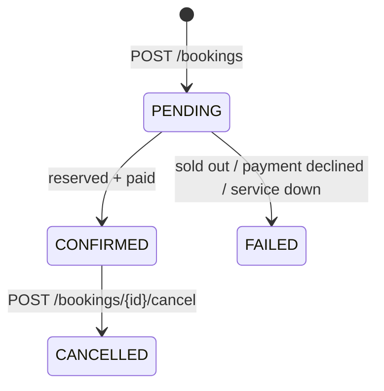
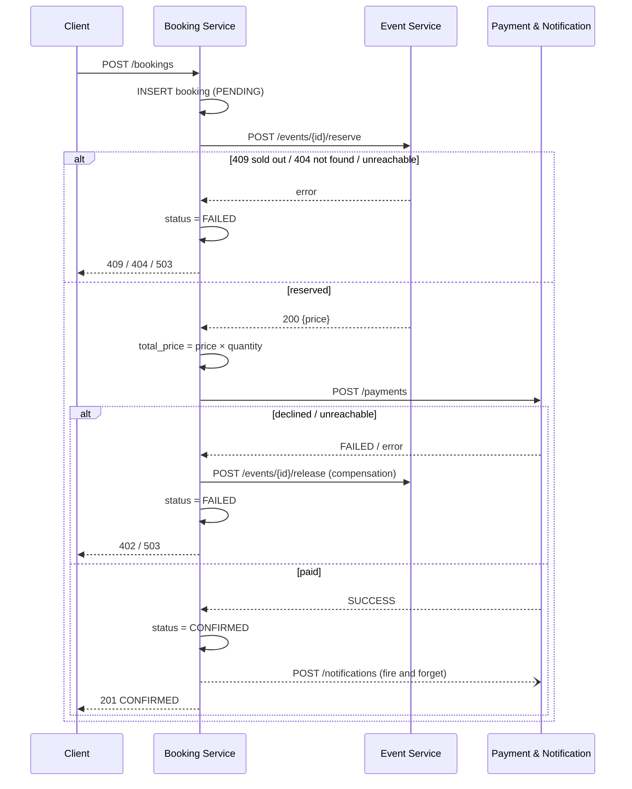

# Documentation chapters – Karol

> Procedure / project planning · Component chapter Booking Service · PostgreSQL setup · Web frontend · Conclusion
> Karol merges all chapters into the final documentation.
>
> Placeholders marked **⟨TODO⟩** still need to be filled in (submission date, personal reflection).

---

## 1. Procedure (project planning)

### 1.1 Team and responsibilities

| Member | Component(s) | Additional responsibility |
|---|---|---|
| Andrin | User Service, Event Service | Requirements chapter |
| Karol | Booking Service | PostgreSQL setup, web frontend, merging and formatting the documentation |
| Marvin | Payment & Notification Service | nginx gateway, Docker Compose, system overview (architecture + HA concept) |

Each member implements, integrates and documents their own component. The split gives every member one service with real logic and one cross-cutting task.

### 1.2 Phases and milestones

The project followed the procedure suggested in the LB2 assignment. Planned and actual dates:

| Phase | Lessons | Content | Milestone | Reached |
|---|---|---|---|---|
| 1. Kick-off & planning | L1–3 | Requirements, interfaces, owners, README as planning document | **M1:** plan approved by the teacher | 21.09.2026 – plan (README) approved by the teacher |
| 2. Setup & proof of concept | L4–5 | Repository, Compose, gateway, atomic reserve prototype | **M2:** HA + consistency concept works | 28.09.2026 – Booking Service skeleton with saga and `db/init.sql`, tested against a mock gateway incl. 50 parallel bookings |
| 3. Implementation | L6–13 | Each member builds their service against the interface contract | **M3:** interim review with the teacher | 19.10.2026 – status meeting with the teacher, all services merged into `main` the same day |
| 4. Integration & HA | L14–16 | Full stack, booking flow end to end, HA tests | **M4:** system running on the VM | 19.10.2026 all services merged into `main` · 26.10.2026 running on the LernMAAS VM |
| 5. Testing & fixes | L17–18 | Test protocol, bug fixes | – | 25.10.2026 frontend fixes, gateway healthcheck fix |
| 6. Documentation & submission | L19–20 | Component chapters, final merge, tag `v1.0` | **M5:** submission | ⟨TODO: submission date⟩ |

### 1.3 Working method

- **Interface first.** Before writing code, all endpoints, request/response bodies, status codes and the auth scheme (JWT for users, `X-Service-Token` for service-to-service calls) were fixed in the README. This allowed each member to develop independently: the Booking Service was built and tested against a small **mock gateway** (`booking-service/dev/mock-gateway.js`) before the Event and Payment services existed.
- **Git workflow.** One shared repository on GitHub. Each member works on a feature branch (`karol/booking-service`, `feature/andrin-user-event-service`, `marvin/payment-notification-gateway`, `karol/frontend`) and merges into `main` through a pull request. `main` always contains a working state; the final submission state is `main`, tagged `v1.0`.
- **Same technology stack.** All services use Node.js 20, Express and PostgreSQL. This was not required, but it let us share patterns (startup DB retry, `/health`, service-token check) and help each other.
- **Testing along the way.** Each component was tested on its own (mock gateway for the Booking Service, `scripts/test-user-event.sh` for User/Event Service) and then end to end through the gateway (test table T1–T13).

### 1.4 Deviations from the plan

- The **web frontend (F11)** was planned as optional for Marvin. Karol implemented it after the integration, because it makes the system much easier to demonstrate.
- On the LernMAAS VM, **port 80 is used by the VM's own web UI (Apache)**. The gateway therefore runs on port **8080** (`HTTP_PORT=8080` in `.env`); no code change was needed.
- Optional items not implemented: F10 (cleanup of stuck `PENDING` bookings), NF7 (OpenAPI), NF8 (PostgreSQL replica). See the conclusion.

---

## 2. Component: Booking Service

### 2.1 Responsibility

The Booking Service runs the **booking flow**. It is the only component that talks to all others: it reserves tickets in the Event Service, charges the customer through the Payment Service, confirms the booking and triggers a notification. It also stores every booking with its status, so customers can see their booking history, and lets customers cancel a confirmed booking.

It owns no tickets and no money itself. It coordinates the other services and makes sure that, whatever fails, the system ends up in a consistent state.

### 2.2 Technology

Node.js 20, Express, `pg`, `jsonwebtoken`. No HTTP client library: service calls use Node's built-in `fetch` with `AbortSignal.timeout`. Port `3000`, own database `bookings_db`.

| File | Content |
|---|---|
| `src/index.js` | Express app, `/health`, error handler, startup and graceful shutdown |
| `src/config.js` | Reads and validates environment variables |
| `src/db.js` | Connection pool, DB retry on startup, table migration |
| `src/auth.js` | JWT check (`requireJwt`) and role check (`requireRole`) |
| `src/clients.js` | Calls to Event, Payment and Notification through the gateway |
| `src/bookings.js` | All `/bookings` routes including the saga |
| `dev/mock-gateway.js` | Stand-in for the other services during development |

### 2.3 Data model

```sql
CREATE TABLE bookings (
  id          SERIAL PRIMARY KEY,
  user_id     INTEGER NOT NULL,
  event_id    INTEGER NOT NULL,
  quantity    INTEGER NOT NULL CHECK (quantity BETWEEN 1 AND 10),
  total_price NUMERIC(10, 2),
  status      TEXT NOT NULL DEFAULT 'PENDING'
              CHECK (status IN ('PENDING', 'CONFIRMED', 'FAILED', 'CANCELLED')),
  created_at  TIMESTAMPTZ NOT NULL DEFAULT now(),
  updated_at  TIMESTAMPTZ NOT NULL DEFAULT now()
);
CREATE INDEX bookings_user_id_idx        ON bookings (user_id);
CREATE INDEX bookings_status_created_idx ON bookings (status, created_at);
```

`user_id` comes from the JWT and `event_id` from the request; there are no foreign keys because users and events live in other services' databases. `total_price` is `NULL` until the Event Service has returned the price. The index on `(status, created_at)` is prepared for the optional cleanup job of stuck `PENDING` bookings (F10).

Status values:



### 2.4 Endpoints

All endpoints require a customer JWT (`Authorization: Bearer …`).

| Method | Path | Body | Response |
|---|---|---|---|
| POST | `/bookings` | `{eventId, quantity, paymentToken}` | `201 booking` · `400` invalid · `401` · `403` not a customer · `402` payment declined · `404` event not found · `409` not enough tickets · `503` a service unavailable |
| GET | `/bookings` | – | `200 [booking]`, own bookings, newest first |
| GET | `/bookings/{id}` | – | `200 booking` · `404` (also for other users' bookings) |
| POST | `/bookings/{id}/cancel` | – | `200 booking` · `404` · `409` not `CONFIRMED` · `503` Event Service unavailable |
| GET | `/health` | – | `200 {status: "ok"}` · `503` if DB unreachable |

```json
{ "id": 7, "userId": 2, "eventId": 1, "quantity": 2, "totalPrice": 99.8,
  "status": "CONFIRMED", "createdAt": "2026-10-19T09:01:32.081Z" }
```

On failure the response contains the error and the failed booking, e.g. `402 { "error": "Payment failed", "booking": { …, "status": "FAILED" } }`.

### 2.5 The booking saga

A booking spans three services with three separate databases, so a single database transaction is not possible. The Booking Service therefore implements a **saga**: a sequence of local steps, where each step that has already succeeded is undone by a **compensation** step if a later step fails.



Key rules in the implementation (`src/bookings.js`):

1. **The booking is written first** (`PENDING`), before any other service is called. Every attempt is therefore traceable, even if the service crashes in the middle.
2. **The reservation is the critical step.** The Event Service decrements `available` atomically (see the Event Service chapter); the Booking Service only reacts to the result. This is why there is no overselling even with two Booking and two Event replicas (test T8).
3. **Compensation.** A local flag `reserved` records whether tickets were taken. Every failure after that point, including unexpected errors such as the database failing mid-saga, calls `release` before the booking is marked `FAILED` (HA measure 5). `release` never throws: if it fails, the error is logged and the booking stays `FAILED`.
4. **Payment result vs. payment error.** `status: "FAILED"` from the Payment Service is a declined card → `402`. A `5xx`, a missing status or a network error means the payment service is broken → release the tickets and answer `503` (test T11).
5. **Notifications are best effort** (HA measure 6). The call is not awaited; errors are only logged. A booking is never rolled back because a notification failed (test T12).
6. **Prices come from the Event Service**, never from the client. `totalPrice = round(price × quantity, 2)`.

### 2.6 Cancelling (F8)

```sql
UPDATE bookings SET status = 'CANCELLED', updated_at = now()
WHERE id = $1 AND user_id = $2 AND status = 'CONFIRMED'
RETURNING *;
```

The status switch is atomic and only succeeds for a `CONFIRMED` booking of this user. Two parallel cancel requests (e.g. a double click hitting both replicas) can't both release the tickets: the second one updates 0 rows and gets `409`. If `release` fails afterwards, the status is set back to `CONFIRMED` and the client gets `503`, so the customer can retry and no tickets are lost.

### 2.7 Other design decisions

- **Service calls go through the gateway** (`GATEWAY_URL=http://gateway/api`), not directly to a container. nginx load-balances and fails over between the two replicas of the target service, so internal calls get the same high availability as client calls.
- **Timeouts.** Every service call is aborted after `UPSTREAM_TIMEOUT_MS` (default 5 s), so a hanging service can't block bookings forever. The request then ends with `503` and compensation.
- **Stateless.** The service keeps no session or in-memory state; everything is in the JWT and the database. Both replicas can handle any request (HA measure 3).
- **Authorization.** Only `customer` tokens can book (`403` otherwise). `GET /bookings/{id}` returns `404` instead of `403` for other users' bookings, so booking IDs can't be probed.
- **Validation.** `eventId` positive integer, `quantity` integer 1–10, `paymentToken` non-empty string, otherwise `400`. Malformed JSON → `400`.
- **Safe migrations with two replicas.** Both replicas create the table on startup. A PostgreSQL advisory lock (`pg_advisory_lock`) makes sure only one runs the `CREATE TABLE` at a time; without it, two parallel `CREATE TABLE IF NOT EXISTS` can fail with a duplicate-type error.
- **Startup and shutdown.** On startup the service waits up to 60 s for the database. On `SIGTERM` (e.g. `docker stop`) it stops accepting connections, finishes running requests and closes the pool.
- **Healthcheck.** `/health` runs `SELECT 1`; Docker marks the container unhealthy if the DB connection is gone.

### 2.8 Configuration

| Variable | Default | Meaning |
|---|---|---|
| `JWT_SECRET` | – (required) | Verifies user tokens, identical in all services |
| `SERVICE_TOKEN` | – (required) | Sent as `X-Service-Token` to internal endpoints |
| `GATEWAY_URL` | `http://gateway/api` | Base URL for service-to-service calls |
| `UPSTREAM_TIMEOUT_MS` | `5000` | Timeout per service call |
| `DB_HOST` / `DB_PORT` | `postgres` / `5432` | Database |
| `DB_USER` / `DB_PASSWORD` / `DB_NAME` | `postgres` / – (required) / `bookings_db` | Credentials |
| `PORT` | `3000` | HTTP port |

The service refuses to start if a required variable is missing, instead of running with an insecure default.

### 2.9 Testing the component

During development the service ran against `dev/mock-gateway.js`, which fakes the Event, Payment and Notification endpoints and can simulate outages (`POST /mock/state {"paymentDown": true}`). With it, all booking outcomes were tested before the other services existed:

| Scenario | Result |
|---|---|
| `tok_ok` → `201 CONFIRMED`, `totalPrice` 99.8, notification sent | PASS |
| `tok_fail` → `402 FAILED`, tickets released | PASS |
| Too many tickets → `409`, unknown event → `404` | PASS |
| Payment down → `503`, tickets released | PASS |
| Notifications down → booking still `201` | PASS |
| Cancel → `CANCELLED`, tickets released; cancel twice → `409` | PASS |
| No token → `401`, organizer → `403`, quantity 11 → `400` | PASS |
| 50 parallel bookings, 9 tickets left → exactly 9 × `201` | PASS |

End-to-end results on the LernMAAS VM are in the test protocol (appendix).

---

## 3. PostgreSQL setup

### 3.1 Database per service

One PostgreSQL 16 container hosts four separate databases. `db/init.sql` is mounted into `/docker-entrypoint-initdb.d/` and runs once, when the data volume is created:

```sql
CREATE DATABASE users_db;
CREATE DATABASE events_db;
CREATE DATABASE bookings_db;
CREATE DATABASE payments_db;
```

Each service connects only to its own database (`DB_NAME`) and creates its own tables on startup. No service reads another service's tables; data from other services is only accessed through their API. This keeps the components independent: a service can change its schema without breaking the others.

### 3.2 Persistence and health

- Data is stored in the named volume `postgres_data`, so it survives `docker compose down` / `up` and VM restarts (test T13). Only `docker compose down -v` deletes it.
- The container has a healthcheck (`pg_isready`). All services wait for `service_healthy` before they start, and additionally retry the connection themselves.
- `restart: always` restarts the database container if it crashes.

### 3.3 Limitation

The database is a **single point of failure**: if the PostgreSQL container is down, no service can work. Restart policy and healthchecks shorten the outage, but don't prevent it. A primary/replica setup (NF8) was planned as optional and not implemented; see the conclusion.

---

## 4. Web frontend (F11, optional)

A single-page web app (`frontend/index.html`, plain HTML/CSS/JavaScript, no build step and no external libraries) served by the nginx gateway at `/`. It only uses the public API through `/api`, exactly like any other client, so it adds no new interfaces.

| Page | Content |
|---|---|
| Home | Search, category filter, featured event, event cards with availability badges |
| Event | Details, ticket box with quantity, test payment cards (`tok_ok` / `tok_fail`), order summary |
| Confirmation | Ticket with order number and code after a successful booking |
| My tickets | Confirmed tickets with cancel button, order history (failed / cancelled) |
| Log in / Sign up | Registration with role selection, login |
| Organizer dashboard | Create and delete events, tickets sold and revenue per event |

Notifications appear in a bell menu in the navigation. Error codes from the API are shown as readable messages, e.g. `402` → "Your payment was declined. No tickets were booked." The page supports dark mode and phone screens.

The JWT is kept in `localStorage`. Data from the API (event titles, usernames, messages) is always inserted with `textContent`, never as HTML, so it can't inject markup or scripts.

---

## 5. Conclusion

### 5.1 Result

The system meets all mandatory requirements. Four independently developed services, each running twice behind an nginx gateway, together sell tickets without ever overselling: in the oversell test, 50 parallel bookings for 10 tickets result in exactly 10 confirmed bookings, also on the LernMAAS VM. Failures of single instances, of the payment service or of notifications are handled, and the system starts with one command (`docker compose up -d --build`).

Optional features implemented: cancelling bookings (F8), protection against deleting events with sold tickets (F9) and a web frontend (F11).

### 5.2 What worked well

- **Fixing the interfaces first.** Because the API was agreed in the README before coding, the four services fit together on the first integration day with only small adjustments.
- **Putting consistency into the database.** Instead of locks between services, the critical check is a single atomic SQL statement. This is simple and correct regardless of the number of replicas.
- **Mock gateway.** The Booking Service could be developed and tested completely, including outage scenarios, before the other services existed.

### 5.3 Problems and how we solved them

| Problem | Cause | Solution |
|---|---|---|
| "Create event" button did nothing | Inline `onclick="createEvent()"` resolved to the built-in `document.createEvent()` | Buttons use `addEventListener` |
| Gateway always shown as `unhealthy` | Healthcheck used `localhost`, which resolves to IPv6 in the container; nginx only listens on IPv4 | Healthcheck uses `127.0.0.1` |
| Port 80 already in use on the VM | LernMAAS VM web UI (Apache) | Gateway on port 8080 via `HTTP_PORT` |
| `docker compose` missing on the VM | Only the Docker engine was preinstalled | Installed the `docker-compose-v2` package |

### 5.4 Outlook

- **Database high availability (NF8):** PostgreSQL primary/replica with automatic failover, to remove the last single point of failure.
- **Cleanup job (F10):** periodically release tickets of bookings stuck in `PENDING`, e.g. if a Booking Service replica crashes between `reserve` and `payment`, or if a `reserve` call times out after the Event Service already reserved the tickets.
- **OpenAPI (NF7):** a machine-readable API description generated from `docs/api.md`.
- **Idempotency keys** for `POST /bookings`, so a client retry after a network error can never create a second booking.

### 5.5 Personal reflection

⟨TODO: Karol – a few sentences in your own words: what you learned (e.g. sagas, distributed consistency, Docker), what you would do differently next time, how the teamwork went.⟩
