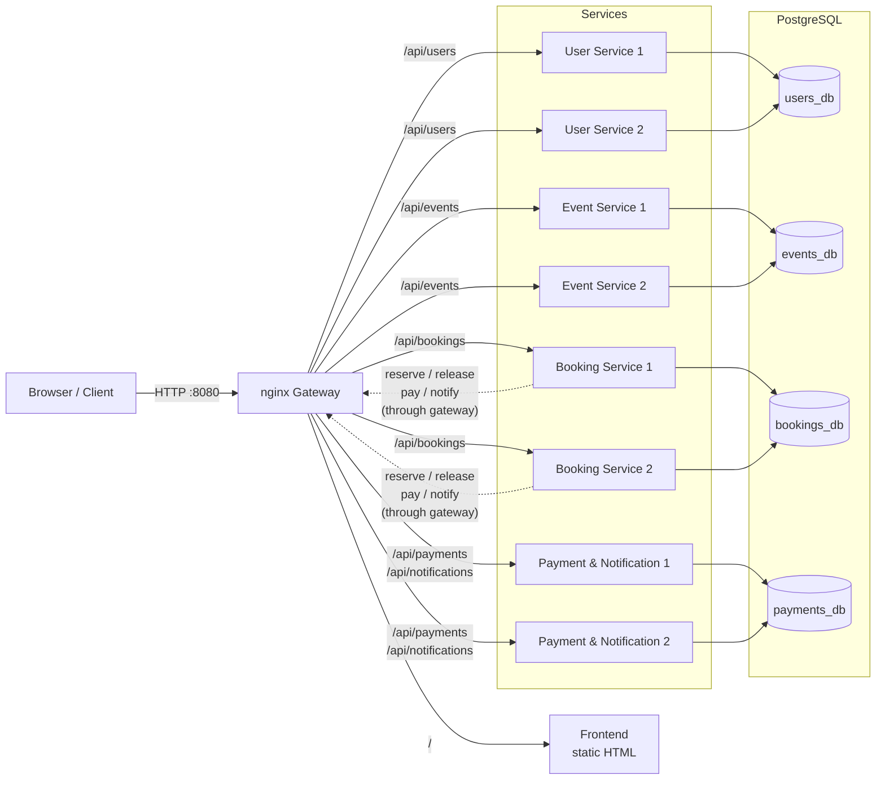
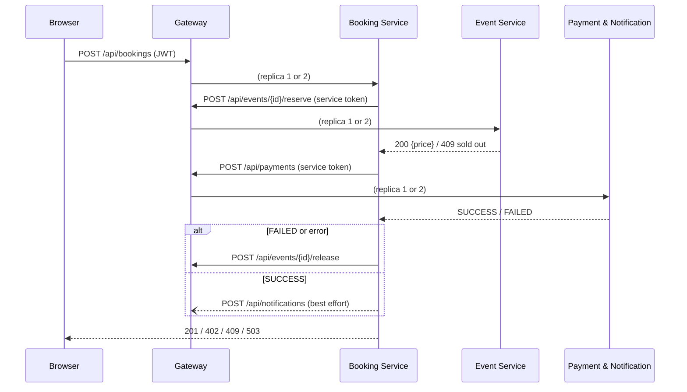

# Documentation chapters – Marvin

> System overview (architecture + HA concept) · Component chapter Payment & Notification Service · nginx gateway · Docker Compose
> Karol merges these into the final documentation.

---

## 1. System overview

### 1.1 Components

The system consists of four independently developed services, a gateway, a database and a web frontend. Every service runs **twice** (two replicas); all traffic goes through the gateway.

| Component | Responsibility | Owner | Database | Replicas |
|---|---|---|---|---|
| nginx gateway | Single entry point, routing, load balancing, failover, serves the frontend | Marvin | – | 1 |
| User Service | Registration, login, JWT issuing, roles | Andrin | `users_db` | 2 |
| Event Service | Event catalog, ticket inventory, atomic reserve/release | Andrin | `events_db` | 2 |
| Booking Service | Booking flow (saga), booking history, cancelling | Karol | `bookings_db` | 2 |
| Payment & Notification Service | Mock payments, notifications | Marvin | `payments_db` | 2 |
| PostgreSQL 16 | One container with one database per service | Karol | – | 1 |
| Web frontend | Single-page app for customers and organizers | Karol | – | served by gateway |

### 1.2 Architecture



**Key points:**

- **One entry point.** Clients only know the gateway (`http://<host>:8080`). The gateway maps `/api/<service>/…` to the right service and serves the frontend at `/`.
- **Service-to-service calls also go through the gateway.** The Booking Service calls `http://gateway/api/events/{id}/reserve` etc. instead of a fixed container. This way internal calls get the same load balancing and failover as client calls.
- **Database per service.** Each service owns its database and creates its own tables. No service reads another service's tables; data from other services is only accessed through their API.
- **Two kinds of authentication.**
  - *Users:* the User Service issues a JWT `{ userId, username, role }`. All services verify it themselves with the shared `JWT_SECRET`, so no service has to ask the User Service at request time.
  - *Services:* internal endpoints (`reserve`, `release`, `payments`, `POST notifications`) require the header `X-Service-Token` with the shared `SERVICE_TOKEN`. Customers can't call them directly.

### 1.3 Interaction: a booking

The most important flow is a booking, which involves all services:



Details of the booking saga are in the Booking Service chapter, details of the atomic reservation in the Event Service chapter.

### 1.4 High-availability concept

The goal: the failure of **any single service instance** must not stop the system, the system must **heal itself**, and the data must stay **consistent** under parallel load.

| # | Measure | Where | Effect | Test |
|---|---|---|---|---|
| 1 | **2 replicas per service** behind nginx, with `max_fails=1 fail_timeout=10s` | Compose, gateway | One instance can fail without an outage; nginx stops sending traffic to it for 10 s | T9 |
| 2 | **Healthchecks + `restart: always`** | Compose, all services | Crashed containers restart automatically; Docker shows whether a service can reach its DB | T10 |
| 3 | **Stateless services (JWT)** | All services | Any replica can handle any request; no session stickiness needed | T9 |
| 4 | **Atomic reservation** | Event Service | No overselling, regardless of how many replicas run | T8 |
| 5 | **Compensation (release)** | Booking Service | Failed bookings give their tickets back | T5, T11 |
| 6 | **Graceful degradation** | Booking Service | If notifications fail, the booking still succeeds | T12 |
| 7 | **Safe retries** | Gateway | nginx fails over to the other replica, but never repeats a POST that already reached a service, so there are no double bookings or double payments | T9 |
| 8 | **Persistent volume** | Compose, PostgreSQL | Data survives restarts and `docker compose down` / `up` | T13 |

Measures 1, 2, 3 and 7 handle **availability** (the system keeps answering), measures 4, 5 and 6 handle **consistency** (the answers stay correct even when parts fail).

**Remaining single point of failure:** PostgreSQL runs as one container. `restart: always` and the healthcheck shorten an outage, but while the database is down no service can work. A primary/replica setup was planned as optional (NF8) and not implemented.

### 1.5 Deployment

The whole system is started with one command on the LernMAAS VM:

```bash
cp .env.example .env      # set JWT_SECRET, SERVICE_TOKEN, DB_PASSWORD, HTTP_PORT
docker compose up -d --build
```

On the VM the gateway listens on port **8080**, because port 80 is used by the VM's own web UI. The application is reachable at `http://10.4.31.20:8080` from inside the LernMAAS VPN.

---

## 2. Component: Payment & Notification Service

### 2.1 Responsibility

The service has two jobs:

1. **Payments:** it charges the customer for a booking. In this project payments are simulated (mock payment), so that tests are deterministic and no real payment provider is needed.
2. **Notifications:** it stores a message for the customer when a booking is confirmed, and lets the customer read their own messages.

Both are called by the Booking Service with the service token; customers only read their notifications with their JWT.

### 2.2 Technology

Node.js 20, Express, `pg`, `jsonwebtoken`. Port `3000`, own database `payments_db`. JSON request bodies are limited to 32 kB.

| File | Content |
|---|---|
| `src/index.js` | Express app, `/health`, error handler, startup and graceful shutdown |
| `src/config.js` | Reads and validates environment variables |
| `src/db.js` | Connection pool, waiting for the DB on startup, table migration |
| `src/auth.js` | JWT check and service-token check |
| `src/payments.js` | `POST /payments` |
| `src/notifications.js` | `POST /notifications`, `GET /notifications` |

### 2.3 Data model

```sql
CREATE TABLE payments (
  id         BIGSERIAL PRIMARY KEY,
  booking_id BIGINT NOT NULL UNIQUE CHECK (booking_id > 0),
  amount     NUMERIC(12, 2) NOT NULL CHECK (amount >= 0),
  status     TEXT NOT NULL CHECK (status IN ('SUCCESS', 'FAILED')),
  created_at TIMESTAMPTZ NOT NULL DEFAULT now()
);

CREATE TABLE notifications (
  id         BIGSERIAL PRIMARY KEY,
  user_id    BIGINT NOT NULL CHECK (user_id > 0),
  message    TEXT NOT NULL CHECK (char_length(message) BETWEEN 1 AND 1000),
  created_at TIMESTAMPTZ NOT NULL DEFAULT now()
);
CREATE INDEX notifications_user_created_idx ON notifications (user_id, created_at DESC);
```

The `UNIQUE` constraint on `booking_id` guarantees that there is at most one payment per booking. The index matches the only query on notifications ("newest messages of one user").

### 2.4 Endpoints

| Method | Path | Auth | Body → Response |
|---|---|---|---|
| POST | `/payments` | Service token | `{bookingId, amount, paymentToken}` → `200 {paymentId, status}` · `400` invalid · `401` |
| POST | `/notifications` | Service token | `{userId, message}` → `201 {id, userId, message, createdAt}` · `400` · `401` |
| GET | `/notifications` | JWT | → `200 [notification]`, own notifications, newest first, max. 100 |
| GET | `/health` | – | `200 {status: "ok"}` · `503` if DB unreachable |

**Mock payment:** `paymentToken: "tok_ok"` → `SUCCESS`, `"tok_fail"` → `FAILED`. Any other token is rejected with `400`.

### 2.5 Design decisions

- **Idempotent payments.** A payment is stored with

  ```sql
  INSERT INTO payments (booking_id, amount, status) VALUES ($1, $2, $3)
  ON CONFLICT (booking_id) DO NOTHING
  RETURNING id, status;
  ```

  If the booking was already paid, nothing is inserted and the stored result is returned. Paying the same booking twice, for example after a retry, never creates a second payment and always gives the same answer. This makes the payment endpoint safe in a distributed system where requests can be repeated.
- **A declined payment is a result, not an error.** `tok_fail` returns `200 {status: "FAILED"}`. The Booking Service can therefore tell a declined card (→ `402` for the customer, tickets released) apart from a broken service (`5xx` or no answer → `503`, tickets released).
- **Notifications are separated by user.** `GET /notifications` takes the `userId` from the JWT, never from a parameter, so customers can only read their own messages.
- **Strict validation.** IDs must be positive integers, the amount between 0 and 9 999 999 999.99, the message 1–1000 characters (trimmed). Invalid JSON → `400`. The database `CHECK` constraints repeat these rules as a second line of defence.
- **Service token.** Only other services can create payments and notifications (`X-Service-Token`); customers get `401`.
- **Startup and shutdown.** The service waits for the database (retry every 2 s) and creates its tables on startup. On `SIGTERM` it finishes running requests and closes the connection pool.
- **Required configuration.** Without `JWT_SECRET`, `SERVICE_TOKEN` or `DB_PASSWORD` the service refuses to start instead of running with an insecure default.

### 2.6 Configuration

| Variable | Default | Meaning |
|---|---|---|
| `JWT_SECRET` | – (required) | Verifies user tokens |
| `SERVICE_TOKEN` | – (required) | Expected `X-Service-Token` for internal calls |
| `DB_HOST` / `DB_PORT` | `postgres` / `5432` | Database |
| `DB_USER` / `DB_PASSWORD` / `DB_NAME` | `postgres` / – (required) / `payments_db` | Credentials |
| `PORT` | `3000` | HTTP port |

---

## 3. nginx gateway

### 3.1 Responsibility

The gateway is the single entry point for clients and for service-to-service calls. It routes requests, balances the load between the two replicas of each service, takes failed replicas out of rotation and serves the web frontend.

### 3.2 Routing

| Path | Target |
|---|---|
| `/api/users…` | `user_service` → `/users…` |
| `/api/events…` | `event_service` → `/events…` |
| `/api/bookings…` | `booking_service` → `/bookings…` |
| `/api/payments…` | `payment_service` → `/payments…` |
| `/api/notifications…` | `payment_service` → `/notifications…` |
| `/health` | answered by nginx itself (`200 ok`) |
| other `/api/…` | `404` |
| `/` | frontend (`frontend/index.html`) |

### 3.3 Load balancing and failover

Each service is an `upstream` with two servers:

```nginx
upstream booking_service {
    zone booking_service 64k;
    server booking-service-1:3000 resolve max_fails=1 fail_timeout=10s;
    server booking-service-2:3000 resolve max_fails=1 fail_timeout=10s;
    keepalive 16;
}
```

- **Round robin** between both replicas.
- **`max_fails=1 fail_timeout=10s`:** after one failed attempt, a replica gets no traffic for 10 seconds, then nginx tries it again.
- **`resolve` with Docker's DNS (`resolver 127.0.0.11 valid=10s`):** if a container is restarted and gets a new IP, nginx finds it again without a reload.
- **`keepalive 16`:** connections to the services are reused, which saves time per request.
- **Timeouts:** connect 3 s, send/read 10 s, so a hanging replica is detected quickly.

### 3.4 Safe retries

```nginx
proxy_next_upstream error timeout http_502 http_503 http_504;
proxy_next_upstream_tries 2;
```

If a replica can't be reached or answers `502/503/504`, nginx sends the request to the other replica. For **non-idempotent requests (POST)** nginx only does this if the request was **not yet sent** to the first replica. A booking or payment that already reached a service is therefore never processed twice, while a request to a stopped container still fails over cleanly (HA measure 7).

The headers `Authorization` and `X-Service-Token` are passed through unchanged.

---

## 4. Docker Compose

`docker-compose.yml` describes the whole system: PostgreSQL, 8 service containers and the gateway.

- **Explicit replicas.** Each replica is its own Compose service with a fixed `container_name` (`booking-service-1`, `booking-service-2`, …). The gateway addresses them by name, and single replicas can be stopped for the demo (`docker stop booking-service-1`).
- **`restart: always`** for every container (HA measure 2).
- **Healthchecks:** every service `wget -qO- http://localhost:3000/health` every 10 s, 3 retries; PostgreSQL `pg_isready`; the gateway `/health`.
- **Start order:** services wait until PostgreSQL is `service_healthy`; the gateway starts after the services.
- **Shared configuration** through YAML anchors (`x-service-environment`, `x-service-healthcheck`), so all services get the same settings and the file stays short.
- **Secrets** come from `.env` (`JWT_SECRET`, `SERVICE_TOKEN`, `DB_PASSWORD`). Compose refuses to start if one is missing (`${VAR:?…}`). `.env` is not committed; `.env.example` shows the format.
- **Persistence** through the named volume `postgres_data`.
- **Port:** the gateway is published on `${HTTP_PORT:-80}`; on the LernMAAS VM `HTTP_PORT=8080`.
